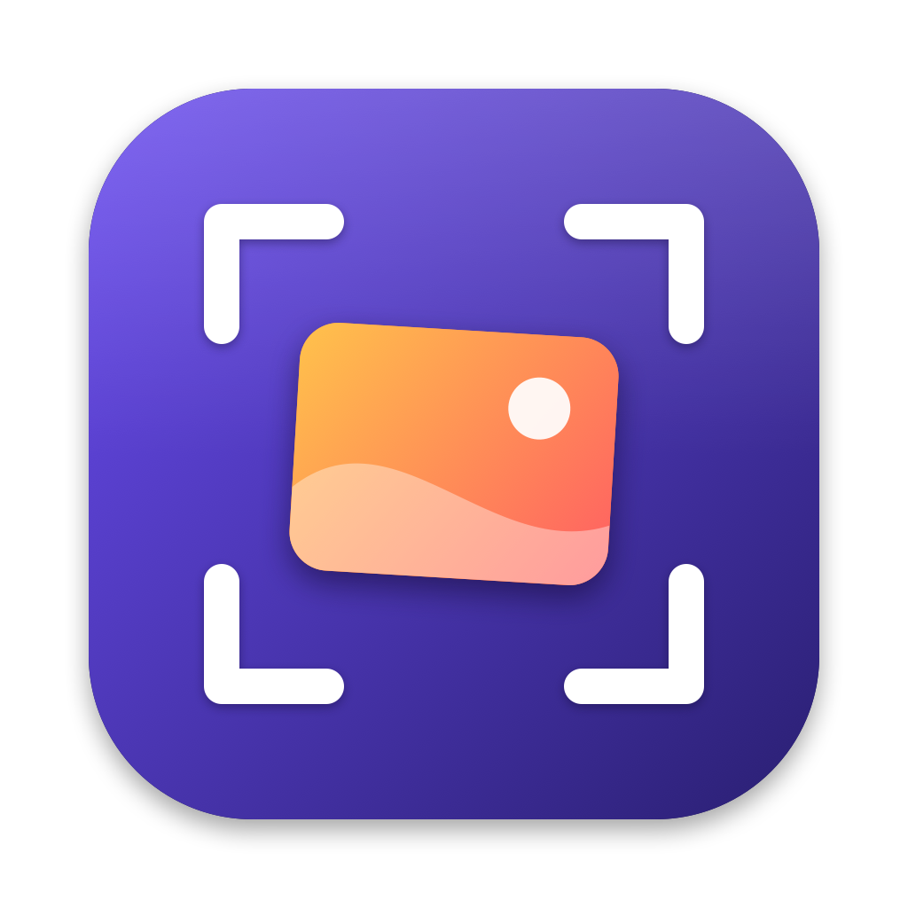
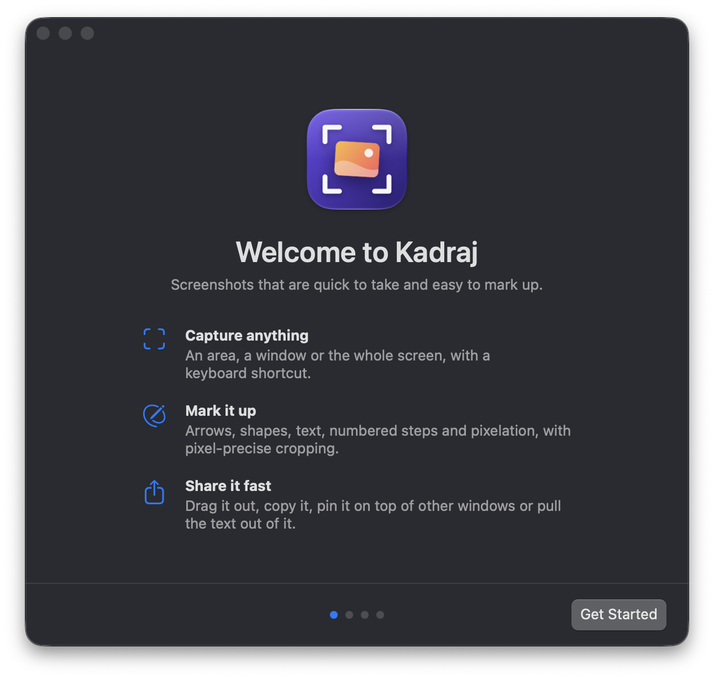

<p align="center">
  
</p>

<h1 align="center">Kadraj</h1>

<p align="center">
  A fast, native, open-source screenshot tool for macOS.<br>
  Capture an area, a window or the whole screen, mark it up, and share it in seconds.
</p>

<p align="center">
  <a href="https://github.com/ardasnturk/kadraj/releases/latest"></a>
  <a href="https://github.com/ardasnturk/kadraj/releases"></a>
  
  
  <a href="LICENSE"></a>
</p>

<p align="center">
  <a href="https://github.com/ardasnturk/kadraj/releases/latest"><b>Download the latest release</b></a>
  ·
  <a href="#features">Features</a>
  ·
  <a href="#keyboard-shortcuts">Shortcuts</a>
  ·
  <a href="#building-from-source">Build from source</a>
</p>

<p align="center">
  
</p>

*Kadraj* is Turkish for "frame", as in framing a shot.

## Features

**Capture**
- Area, window or full screen from a global shortcut. The screen freezes while you select.
- Pick a window with Space, take the whole display with Return, hold ⇧ for a square.
- Repeat the last area with one key, or capture the full screen after a 3-second countdown.

**Act on it right away**
- A floating preview appears after every capture. Drag it straight into another app, or edit, copy, save, pin or read its text with one click.
- Pin screenshots above every window, right where you took them. Scroll to resize, ⌥-scroll to fade.
- Copy the text or a QR code's contents from any area (OCR). Recognition runs on your Mac with Apple's Vision framework.

**Mark it up**
- Arrows, rectangles, ovals, text, numbered steps and pixelation.
- Pixel-precise cropping with free zoom and pan. Arrow keys nudge the selection by 1 px.
- Copy (⌘C) or save (⌘S) as PNG or JPEG. Retina captures keep their resolution.

**Feels at home on the Mac**
- A welcome guide sets up the Screen Recording permission and your shortcuts, then shows you around.
- Updates arrive automatically through [Sparkle](https://sparkle-project.org), signed and notarized.
- Lives in the menu bar, launches at login if you like, and stays out of the way.

## Installation

1. Download `Kadraj-<version>.dmg` from the [latest release](https://github.com/ardasnturk/kadraj/releases/latest).
2. Open it and drag **Kadraj** into **Applications**.
3. Launch Kadraj. The welcome guide walks you through the Screen Recording permission and your shortcuts.

Kadraj checks for updates on its own. You can also choose **Check for Updates…** from the menu bar icon, or turn automatic checks off in **Settings › General**.

> [!NOTE]
> macOS only applies the Screen Recording permission after Kadraj restarts. The guide notices when you switch it on and offers to restart for you.

## Keyboard shortcuts

You can change every global shortcut in **Settings › Shortcuts** or in the welcome guide.

| Where | Key | Action |
|---|---|---|
| Anywhere | ⇧⌘2 | Capture an area |
| Anywhere | ⇧⌘1 | Capture the full screen |
| Anywhere | *your choice* | Capture a window, repeat the last area, capture text |
| Selecting | Space · Return · ⇧ | Window mode · whole display · square selection |
| Selecting | Esc | Cancel |

<details>
<summary><b>Editor shortcuts</b></summary>

| Key | Action |
|---|---|
| V A R O T B N | Select and crop, arrow, rectangle, oval, text, pixelate, step |
| B with a selection | Pixelate the selection |
| ← → ↑ ↓ (⇧, ⌘) | Nudge the selection or object (by 10 px, resize) |
| Return / Esc | Crop / clear the selection, then close |
| ⌘0 ⌘1 ⌘= ⌘- | Actual size, fit, zoom in, zoom out |
| Pinch, ⌘-scroll, mouse wheel | Zoom |
| Space-drag, right-drag, trackpad scroll | Pan |
| ⌘C ⌘S ⇧⌘S | Copy, save, save as |
| ⌥⌘C ⌘P | Copy text (OCR), pin to screen |
| ⌘Z ⇧⌘Z | Undo, redo |

</details>

## Building from source

Requires macOS 14 or later and Xcode 16 or later.

```bash
git clone https://github.com/ardasnturk/kadraj.git
cd kadraj
./scripts/build-app.sh
open build/Kadraj.app
```

`build-app.sh` builds a release binary with SwiftPM, wraps it in `build/Kadraj.app` with Sparkle embedded, and code-signs it. It picks your first *Developer ID Application* identity, then *Apple Development*, and falls back to ad-hoc signing. Set `SIGN_IDENTITY` to choose one.

> [!TIP]
> Keep the signing identity the same from build to build. macOS ties the Screen Recording permission to the signature, so with ad-hoc signing you grant it again after every rebuild.

You can also open `Package.swift` in Xcode. These flags jump straight to a piece of UI:

```bash
build/Kadraj.app/Contents/MacOS/Kadraj --open path/to/image.png     # editor
build/Kadraj.app/Contents/MacOS/Kadraj --preview path/to/image.png  # floating preview
build/Kadraj.app/Contents/MacOS/Kadraj --settings                   # settings window
build/Kadraj.app/Contents/MacOS/Kadraj --onboarding                 # welcome guide
```

<details>
<summary><b>Publishing a release</b></summary>

1. Bump `CFBundleShortVersionString` and `CFBundleVersion` in `Resources/Info.plist`, and commit.
2. Run `./scripts/release.sh`.

The script:
- signs the app with your *Developer ID Application* identity,
- builds `build/Kadraj-<version>.dmg` and notarizes it with the `kadraj-notary` notarytool profile,
- writes `build/appcast.xml` signed with the Sparkle EdDSA key stored in your Keychain under the `kadraj` account,
- tags the commit and uploads both files as a GitHub release.

The app's feed URL points at `releases/latest/download/appcast.xml`, so each release replaces the previous feed.

| Variable | Default | Purpose |
|---|---|---|
| `NOTARY_PROFILE` | `kadraj-notary` | notarytool Keychain profile |
| `SPARKLE_ACCOUNT` | `kadraj` | Keychain account of the Sparkle key |
| `SIGN_IDENTITY` | first Developer ID | Code signing identity |
| `SKIP_PUBLISH` | unset | Build the DMG and appcast without tagging or releasing |

The DMG window is laid out with [dmgbuild](https://github.com/dmgbuild/dmgbuild) (`pipx install dmgbuild`), and its background is drawn by `scripts/make-dmg-background.swift`. The app icon comes from `scripts/make-icon.swift`, which writes `Resources/AppIcon.icns`.

</details>

## Project layout

```
Sources/Kadraj/
  App/         App delegate, menu bar item, hot keys, permissions, updater, settings storage, toasts
  Capture/     ScreenCaptureKit capture, area and window selection, text recognition
  Editor/      Document model, renderer, canvas and editor window
  Onboarding/  Welcome guide
  Preview/     Floating capture preview and pinned screenshots
  Settings/    Settings window and the shortcut recorder
scripts/       Build, release, icon and DMG background scripts
Resources/     Info.plist and the app icon
```

## Roadmap

- [x] Notarized releases
- [x] Automatic updates
- [x] Welcome guide
- [ ] Color picker, ruler and contrast checker
- [ ] Backdrop (gradient background, padding, rounded corners, shadow)
- [ ] Scrolling capture
- [ ] Magnifier loupe in area capture
- [ ] Combine multiple captures and paste images as layers
- [ ] Localization
- [ ] Homebrew cask

## Contributing

Issues and pull requests are welcome. Please keep Kadraj small, avoid new dependencies unless they clearly pay for themselves, and match the style of the surrounding code.

## License

Kadraj is released under the [MIT License](LICENSE).
